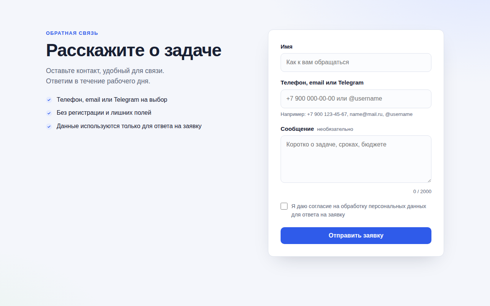

# PHP Lead Form

Форма заявки на чистом PHP 8 без фреймворков и Composer: копируется на любой хостинг с PHP, заявки приходят в Telegram и на почту и сохраняются в файл. Основной упор на защиту от ботов и флуда.



## Возможности

**Для посетителя**
- Адаптивная форма: имя, контакт (телефон, email или @username в Telegram), сообщение, согласие на обработку персональных данных
- Отправка через `fetch` без перезагрузки страницы, кнопка с индикатором загрузки
- Ошибки показываются под конкретным полем, первое поле с ошибкой получает фокус
- Те же правила проверки работают в браузере и на сервере, счётчик символов в сообщении

**Для владельца**
- Уведомления в Telegram через Bot API (curl) и на почту через `mail()`, каналы включаются в конфиге независимо
- Каждая заявка дописывается в `data/leads.jsonl`, даже если доставка не удалась
- Ошибки пишутся в `data/error.log`, пользователь видит только общее сообщение

**Защита**
- Только `POST` (иначе 405), CSRF-токен из сессии, выдаётся через `token.php`
- Honeypot-поле: бот получает `200 {"ok": true}`, но заявка не сохраняется
- Минимальное время заполнения 3 секунды, отсчёт идёт на сервере от выдачи токена
- Лимит 5 заявок за 10 минут с одного IP, хранится только HMAC-хэш IP с солью
- Поля очищаются от управляющих символов и обрезаются по длине, заголовки письма защищены от инъекций
- `data/` закрыта `.htaccess` и пустым `index.html`, конфиг тоже недоступен по HTTP

## Стек

PHP 8.1+ (расширения mbstring, curl, session), HTML, CSS, JavaScript без библиотек, JSON Lines, bash и curl для тестов, GitHub Actions с setup-php.

## Как запустить

```bash
cp config.example.php config.php   # задать salt, при необходимости Telegram и почту
php -S 127.0.0.1:8000              # http://127.0.0.1:8000
```

На хостинге: загрузить файлы в папку сайта, создать `config.php`, убедиться, что PHP может писать в `data/`.

Тесты (нужны `php` и `curl`):

```bash
bash tests/run.sh
```

Скрипт поднимает `php -S 127.0.0.1:8099` с тестовым конфигом (Telegram и почта выключены, данные во временной папке) и проверяет: GET даёт 405, запрос без токена 403, honeypot отвечает 200 и ничего не пишет, слишком быстрая отправка 422, пустые поля 422 с ошибками по полям, валидная заявка 200 и строка в `leads.jsonl`, шестая заявка 429. Порт меняется переменной `PORT`. Тесты запускаются в GitHub Actions на PHP 8.1 и 8.3.

### Ответы send.php

| Код | Тело | Когда |
|---|---|---|
| 200 | `{"ok": true, "message": ...}` | заявка принята (или сработал honeypot) |
| 403 | `{"error": "csrf"}` | нет токена или он не совпал |
| 405 | `{"error": "method_not_allowed"}` | метод не `POST` |
| 422 | `{"error": "too_fast"}` | с выдачи токена прошло меньше 3 секунд |
| 422 | `{"error": "validation", "errors": {"name": ...}}` | ошибки в полях |
| 429 | `{"error": "rate_limit"}` | лимит исчерпан, есть заголовок `Retry-After` |
| 500 | `{"error": "server_error"}` | сбой на сервере, подробности в `data/error.log` |

## Настройка

Все параметры в `config.php` (шаблон `config.example.php`):

| Ключ | Назначение |
|---|---|
| `salt` | случайная строка от 16 символов для хэша IP, без неё форма не работает |
| `telegram.enabled`, `bot_token`, `chat_id` | токен от @BotFather и id чата или канала |
| `mail.enabled`, `to`, `from`, `subject` | адрес получателя, отправителя и тема письма |
| `min_fill_seconds` | минимальное время заполнения, по умолчанию 3 |
| `rate_limit.max`, `rate_limit.window` | число заявок и окно в секундах, по умолчанию 5 за 600 |
| `trust_proxy` | брать IP из `X-Forwarded-For`, если сайт за Cloudflare или nginx |
| `data_dir`, `timezone` | папка для данных и часовой пояс времени заявок |

Путь к конфигу можно переопределить переменной окружения `LEAD_FORM_CONFIG`. Тексты формы и преимущества слева меняются в `index.html`, цвета в начале `assets/style.css`.

На nginx `.htaccess` не работает, закройте папки вручную:

```nginx
location ~ ^/(data|src|tests)/ { deny all; }
location ~ ^/config(\.example)?\.php$ { deny all; }
```

## Структура проекта

```
index.html          # страница с формой
assets/style.css    # стили, адаптивная сетка
assets/form.js      # получение токена, проверка полей, отправка через fetch
token.php           # выдаёт CSRF-токен и запоминает время открытия формы
send.php            # приём заявки: проверки, лимит, запись, доставка
src/bootstrap.php   # скрытие ошибок, лог, конфиг, сессия, JSON-ответы
src/lead.php        # валидация, лимит по IP, запись, Telegram и почта
config.example.php  # шаблон конфига
data/               # leads.jsonl, ratelimit.json, error.log (закрыта от веба)
tests/run.sh        # интеграционные тесты через php -S и curl
tests/config.test.php  # конфиг для тестов
.htaccess           # запрет листинга и доступа к конфигу
```

## Как это устроено

- Проверки идут в порядке: метод, CSRF, honeypot, время заполнения, валидация, лимит по IP, запись, доставка. Неверные и ботовые запросы не расходуют лимит.
- Лимит хранится в `data/ratelimit.json` как массив отметок времени для каждого хэша. Файл открывается с `flock(LOCK_EX)`, проверка и запись проходят под одной блокировкой, устаревшие отметки удаляются при каждом обращении.
- IP превращается в `hash_hmac('sha256', ip, salt)`: этого хватает, чтобы считать заявки, но адрес из хэша не восстановить. В саму заявку попадают только первые 16 символов хэша.
- Предупреждения PHP превращаются в исключения, глобальный обработчик пишет их в лог и отдаёт JSON 500. Сбой Telegram или почты только логируется, потому что заявка к этому моменту уже сохранена.
- Сессионная cookie с `HttpOnly`, `SameSite=Strict`, `Secure` при HTTPS и `use_strict_mode`, токены сравниваются через `hash_equals`.

## Идеи для развития

- Простая страница просмотра заявок под паролем
- Капча (Яндекс SmartCaptcha или Turnstile) как дополнительный уровень
- Отправка через SMTP вместо `mail()`
- Автоочистка старых заявок по сроку хранения

## Лицензия

MIT © 2026 whysafe. Telegram: [@yawhysafe](https://t.me/yawhysafe) · Сайт: [whysafe.ru](https://whysafe.ru)
